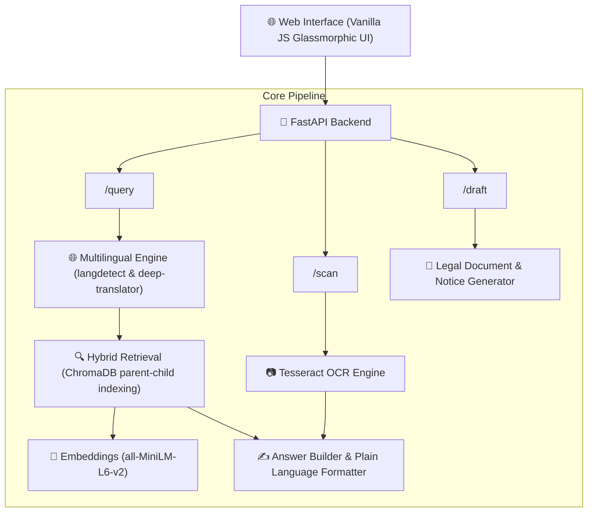

<div align="center">

# ⚖️ Nyaya — AI-Powered Indian Legal Advisory System

**Democratizing access to Indian legal guidance with plain-language explanations, multilingual support, and automated procedural drafting.**

[](https://python.org)
[](https://fastapi.tiangolo.com)
[](https://trychroma.com)
[](https://docker.com)
[](LICENSE)

[Features](#-key-features) • [Architecture](#-architecture) • [Getting Started](#-getting-started) • [API Reference](#-api-endpoints) • [Team](#-the-team)

</div>

---

> ⚠️ **Disclaimer:** Nyaya is designed for educational and informational purposes under legal awareness initiatives. It provides structured guidance and procedural awareness, not formal legal representation.

---

## 💡 Why Nyaya?

Traditional legal portals are filled with dense statutory jargon, scattered across multiple acts, and inaccessible to citizens who don't read English or legal parlance. 

**Nyaya bridges this gap:**
1. **Explain Like a Lawyer:** Translates complex legal sections into clear, everyday language with concrete next steps.
2. **Indian Law Focus:** In-depth coverage across RERA, Consumer Protection Act 2019, Central Acts, and statutory legal notice procedures.
3. **Multilingual Access:** Native query support across Hindi, Kannada, Tamil, Telugu, Marathi, and more.
4. **Notice Scanner & Legal Drafting:** Scan legal notices using OCR and generate formal legal complaints/notices ready to be served.

---

## 🏗️ Architecture



---

## ⚡ Key Features

- **🔎 Hybrid Vector Retrieval:** Hierarchical chunking stored in ChromaDB vector store for accurate statutory retrieval without hallucinations.
- **🗣️ Multilingual Support:** Ingestion and real-time query translation for 10+ Indian regional languages.
- **📷 Smart Notice Scanner:** OCR parsing for physical legal letters, extracting sender, demands, and reply deadlines.
- **📝 Automated Draft Generation:** Generates standardized legal notices (e.g. consumer defect complaints, delayed possession notices) following Indian civil procedures.
- **🪶 Ultra-Lightweight & Deployable:** Engineered with low-memory fallback profiles to run smoothly even on 512MB RAM cloud containers.

---

## 🚀 Getting Started

### Prerequisites
- Python 3.11+
- [Ollama](https://ollama.com) (Optional, for local LLM inference)
- [Tesseract OCR](https://github.com/tesseract-ocr/tesseract) (For notice scanning features)

### Quick Installation

```bash
# 1. Clone the repository
git clone https://github.com/Shreyasshreyas10/Nyaya-Legal-AI.git
cd Nyaya-Legal-AI/nyaya

# 2. Set up virtual environment
python -m venv venv
# On Windows:
venv\Scripts\activate
# On Linux/macOS:
source venv/bin/activate

# 3. Install dependencies
pip install -r requirements.txt

# 4. Verify system configuration
python verify_setup.py

# 5. Launch development server
uvicorn api.main:app --host 0.0.0.0 --port 8000 --reload
```

Access the UI at `http://localhost:8000` and Swagger docs at `http://localhost:8000/docs`.

### 🐳 Run with Docker

```bash
docker build -t nyaya-legal-ai .
docker run -p 8000:8000 nyaya-legal-ai
```

---

## 🔌 API Endpoints

| Method | Endpoint | Description |
|---|---|---|
| `GET` | `/` | Serves the interactive browser UI |
| `POST` | `/query` | Answers legal questions with statutory citations and plain advice |
| `POST` | `/scan` | Extracts text from uploaded legal notices via OCR |
| `POST` | `/draft` | Generates procedural legal notices or consumer complaint drafts |
| `POST` | `/feedback` | Collects user evaluation for continuous alignment |

---

## 👥 The Team

| Name | Role | Institution |
|---|---|---|
| **Shreyas Savant** | AI & RAG Pipeline Architecture | KLE Technological University |
| **Pooja Managuli** | System Design & Evaluation | KLE Technological University |
| **Anusha Kattimani** | Multilingual & Data Pipeline | KLE Technological University |
| **Kushal Itnal** | Backend API & Integration | KLE Technological University |

---

<div align="center">
  <sub>Built with ❤️ for accessible justice. If you find this project helpful, please consider giving it a ⭐!</sub>
</div>
